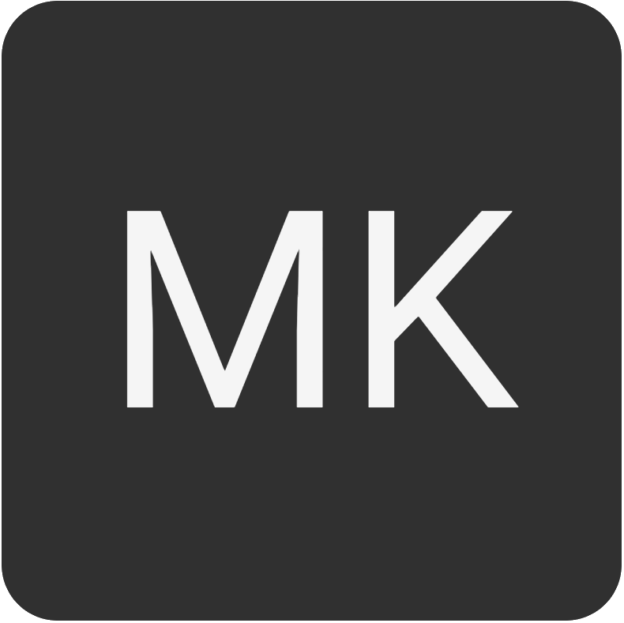

<p align="center">
  
</p>
<h1 align="center">maciejkopec.pl</h1>
<p align="center">
  My personal portfolio is a static site I built to explore <a href="https://www.gatsbyjs.org/" target="_blank">Gatsby</a>.
</p>
<p align="center">
  <a href="https://app.netlify.com/sites/plmaciejkopec-ui/deploys" target="_blank">
    
  </a>
</p>
<p align="center">
  <em>Feel free to reuse any part of this project under the MIT license.</em>
</p>

## Quick start

1. Clone the repository and install its dependencies.

   ```sh
   git clone https://github.com/maciejkopecpl/cms-ui.git
   cd cms-ui
   yarn install
   ```

2. Use [empty.env](empty.env) as a template for `.env.development` and fill in the values for your environment.

3. Start the development server and open <http://localhost:8000>.

   ```sh
   yarn develop
   ```

## Project structure

| Path | Purpose |
| --- | --- |
| `src/` | Pages, components, styles, and assets for the portfolio. |
| `.babelrc` | Babel configuration. |
| `.gitignore` | Patterns for files Git should ignore. |
| `.prettierignore` and `.prettierrc` | Prettier ignore patterns and formatting settings. |
| `empty.env` | Template for the project's environment variables. |
| `gatsby-config.js` | Site metadata and Gatsby plugin configuration. |
| `gatsby-node.js` | Gatsby Node API hooks for customizing the build. |
| `package.json` | Project metadata, dependencies, and scripts. |
| `yarn.lock` | Exact dependency versions resolved by Yarn. |

## Backend

The portfolio gets its content from a separate CMS. See the [CMS backend repository](https://github.com/maciejkopecpl/cms).

## License

[MIT](LICENSE)
